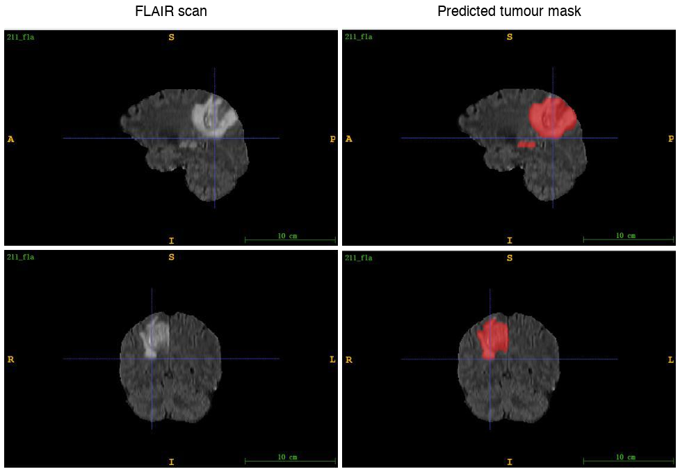
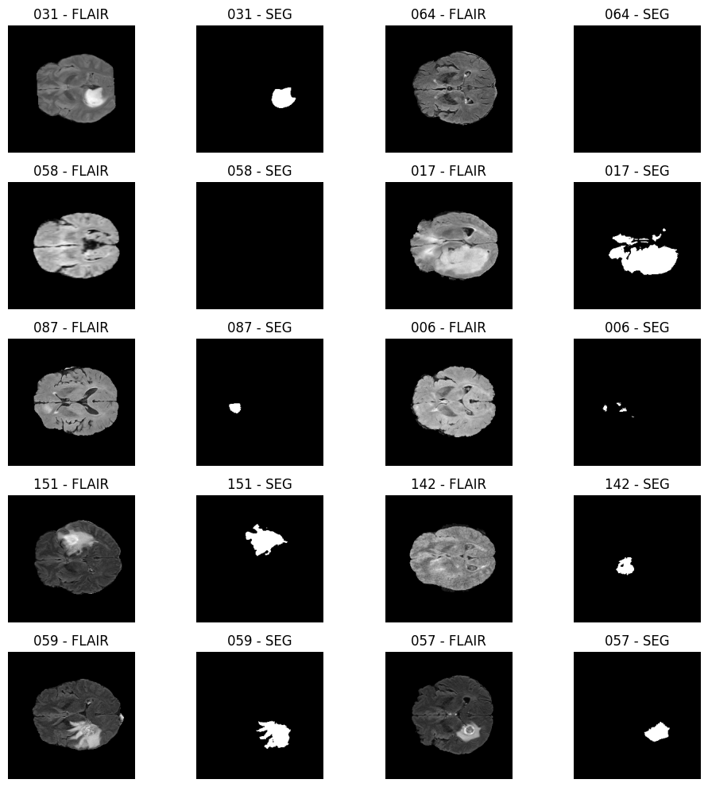
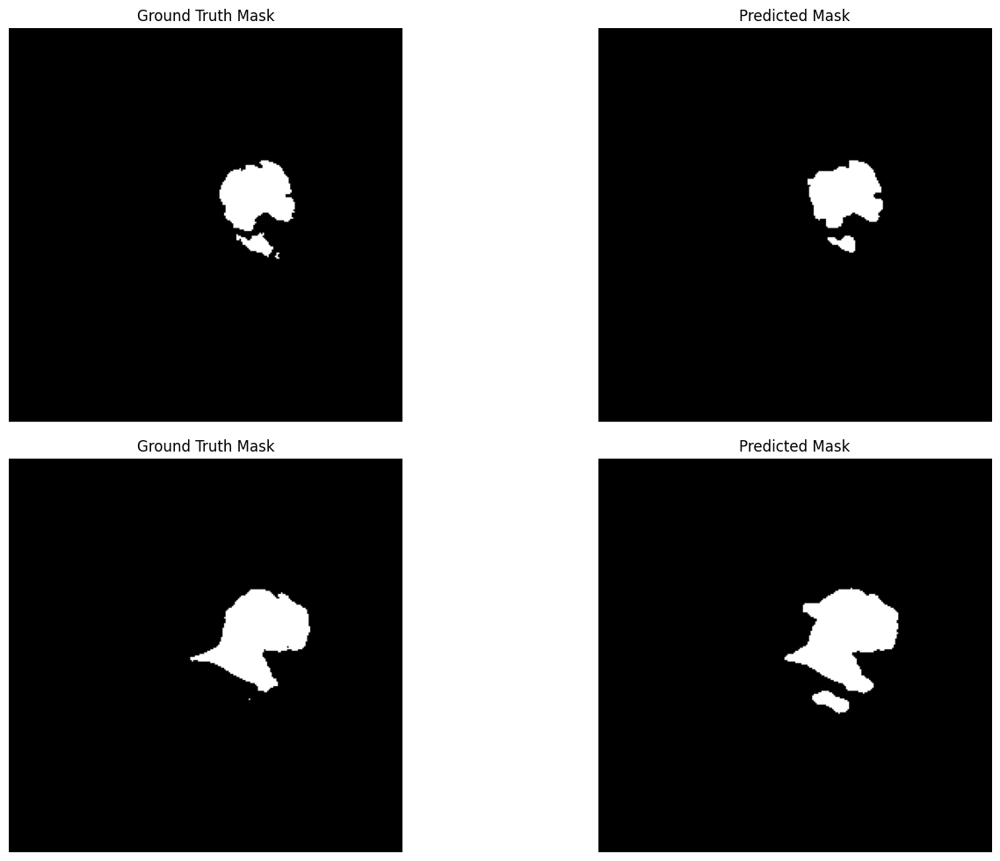

# Brain Tumour Segmentation on MRI with a U-Net

Gliomas are the most common malignant brain tumours, and outlining them on an MRI scan by
hand takes a radiologist a long time. We train a **deep learning model in PyTorch** that
does it automatically: for every voxel of a 3D brain scan it predicts tumour or not tumour.

> Team project, **DSI Summer School 2025, Imperial College London**.

<p>
  
  
  
  
  
</p>



<p align="center"><sub>A scan from the test set, never seen during training: on the right, the tumour predicted by our model in red.</sub></p>

---

## At a glance

| | |
| --- | --- |
| **Task** | Semantic segmentation of gliomas on 3D FLAIR MRI scans (240 × 240 × 155 voxels). |
| **Data** | 210 annotated scans for training and validation, 41 test scans without labels scored by the organisers. No external data or pretrained weights allowed. |
| **Approach** | 2D U-Net on axial slices with a ResNet-18 encoder trained from scratch, Tversky loss to limit missed tumour regions, data augmentation, checkpointed training on a cloud GPU. |
| **Result** | **Dice score 86.5%** on 42 held-out validation scans. |
| **Skills** | Deep learning with PyTorch, convolutional networks for segmentation, medical imaging (NIfTI), data pipelines and augmentation, loss design for class imbalance, GPU training, model evaluation. |

---

## How it works

**1. Data.** Each scan is a 3D FLAIR MRI volume with a binary mask drawn by experts. Tumours
vary a lot in size, shape and position, and most slices contain little or no tumour.



**2. Split by patient.** 80% of the scans (168) for training and 20% (42) for validation.
Slices of the same patient never appear on both sides, so the validation score measures how
the model does on new patients.

**3. Data pipeline.**
- Each 3D volume is cut into 155 axial 2D slices.
- Each slice is z-score normalised and padded from 240 × 240 to 256 × 256 (the U-Net needs
  a size divisible by 32).
- In training, 30% of the slices with almost no tumour are dropped, so that the model sees
  more informative examples.
- Augmentation in training: flips, small shifts, scaling and rotations, brightness and
  contrast changes.

**4. Model.** A **U-Net**: an encoder compresses the image, a decoder rebuilds a full-size
mask, and skip connections carry the fine details of the tumour borders from one to the
other. The encoder is a **ResNet-18**, trained from scratch.

**5. Loss and training.** The **Tversky loss** (α = 0.3, β = 0.7) penalises missed tumour
pixels more than false alarms: in a clinical setting, missing part of a tumour is the worse
error. Adam optimiser, learning rate halved when the validation Dice stops improving, early
stopping, and a checkpoint after every epoch to survive Colab disconnections.

**6. Test predictions.** Each test volume is predicted slice by slice, the padding is
removed and the slices are stacked back into a 3D mask saved as NIfTI.

---

## Results

| | Dice score | Tversky loss |
| --- | ---: | ---: |
| Training | 81.9% | 0.193 |
| **Validation (42 unseen patients)** | **86.5%** | **0.144** |

The Dice score measures the overlap between the predicted and the true tumour: 100% is a
perfect match. The validation score is higher than the training one, most likely because
the training slices are augmented and selected to contain more tumour, which makes them
harder to segment.



**What made the difference**

- **ResNet-18 instead of ResNet-50.** The deeper encoder overfitted our 168 training scans
  and converged slowly; the smaller one generalised better.
- **Tversky instead of Dice loss.** The Dice loss missed small tumours; weighting false
  negatives more made the model more sensitive to them.
- **Padding instead of resizing.** Resizing 240 → 256 blurred the tumour borders and hurt the
  results; zero-padding keeps every pixel intact.

**Limits.** The model works on 2D slices, so it does not use the context of the neighbouring
slices (a 3D U-Net would). The official test labels were kept by the organisers, so the
validation set is our measure of performance.

---

## Repository layout

```
├── brain_tumour_segmentation.ipynb   the full pipeline: data, model, training, evaluation, test predictions
├── docs/images/                      the figures of this README
├── requirements.txt
└── data/                             (not tracked, see below)
```

---

## Run it

```bash
python -m venv .venv && source .venv/bin/activate
pip install -r requirements.txt
jupyter notebook brain_tumour_segmentation.ipynb
```

A GPU is strongly recommended: one epoch takes about 70 minutes on a Colab GPU.

**Data.** The MRI scans were provided by the course and are not redistributed here. The
notebook expects them in `data/train/<id>/<id>_fla.nii.gz` and `<id>_seg.nii.gz`, and the
test scans in `data/test/<id>/<id>_fla.nii.gz`.

---

## Team

Team project carried out at the DSI Summer School 2025, Imperial College London.
